# 20 Claude animation styles

Twenty animation styles that Claude (or any AI that writes code) can draw with nothing but inline SVG and a little JavaScript: pixel art, paper cutout, blueprint, neon, flat vector, comic book, chalkboard, claymation, risograph, watercolor, stained glass, shadow puppet, ukiyo-e, low poly, bauhaus, notebook doodle, sticker, glitch, felt & stitch, art deco. One prompt per style, with a picture of what it looks like.

## Two ways to use it

**1. Give your AI the whole skill.** Paste this into the chat and name the style you want:

```text
Read https://raw.githubusercontent.com/pahesilva1/skillpedia-skills/main/claude-animation-styles/SKILL.md and follow it. Animate this scene in the [STYLE NAME] style: [DESCRIBE YOUR SCENE HERE].
```

In Claude Code, Codex or Cursor you can also install it: `npx skills add pahesilva1/skillpedia-skills --skill claude-animation-styles`

**2. Copy a single prompt.** Pick a style below, copy its prompt, replace `[DESCRIBE YOUR SCENE HERE]` with your scene and paste it into your AI. It answers with one HTML file: open it in your browser to watch the animation. To see the same scene in another style, keep your scene and use the next prompt.

## 01 · Pixel Art

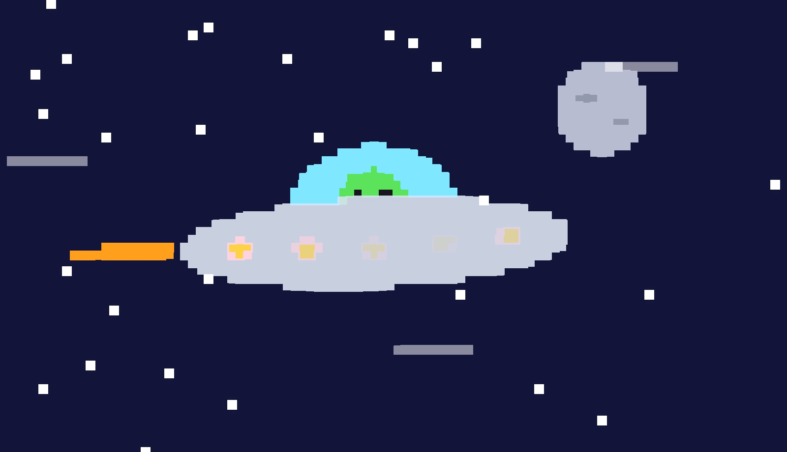

```text
Make an animated scene as ONE self-contained HTML file (inline SVG + vanilla JavaScript, no libraries, no external images or fonts), 16:9, looping every 6 seconds. Scene: [DESCRIBE YOUR SCENE HERE]. Draw every character and object from simple SVG shapes (ellipses, rounded rectangles, paths, thick round-capped lines for arms and legs). Drive everything from one time variable so the loop is seamless. Style: PIXEL ART. Flat colors only, no outlines and no gradients. Snap the whole drawing to an 8-px grid with an SVG mosaic filter: feFlood (x=3 y=3 width=2 height=2) → feComposite (width=8 height=8) → feTile → feComposite in=SourceGraphic operator=in → feMorphology dilate radius=4. The filter must use filterUnits="userSpaceOnUse" covering the whole frame, and the group needs shape-rendering="crispEdges". Use a small retro-console palette (deep navy background, 12 to 16 saturated colors). Animate at 12 frames per second and move things in whole-pixel steps. Stars are single 8-px squares.
```

## 02 · Paper Cutout


```text
Make an animated scene as ONE self-contained HTML file (inline SVG + vanilla JavaScript, no libraries, no external images or fonts), 16:9, looping every 6 seconds. Scene: [DESCRIBE YOUR SCENE HERE]. Draw every character and object from simple SVG shapes (ellipses, rounded rectangles, paths, thick round-capped lines for arms and legs). Drive everything from one time variable so the loop is seamless. Style: PAPER CUTOUT. Every shape is a piece of cut paper: flat muted colors (kraft, cream, dusty blue, sage, mustard), no outlines. Give each layer a soft drop shadow (feDropShadow dx=2.5 dy=5 stdDeviation=2.6, dark, 50% opacity) so the layers look stacked on a table. Add a paper-grain overlay on top (feTurbulence fractalNoise baseFrequency=0.9, blended with multiply at about 50%). Animate on twos (12 fps) like stop motion: layers slide, tilt and rotate, they never morph.
```

## 03 · Blueprint

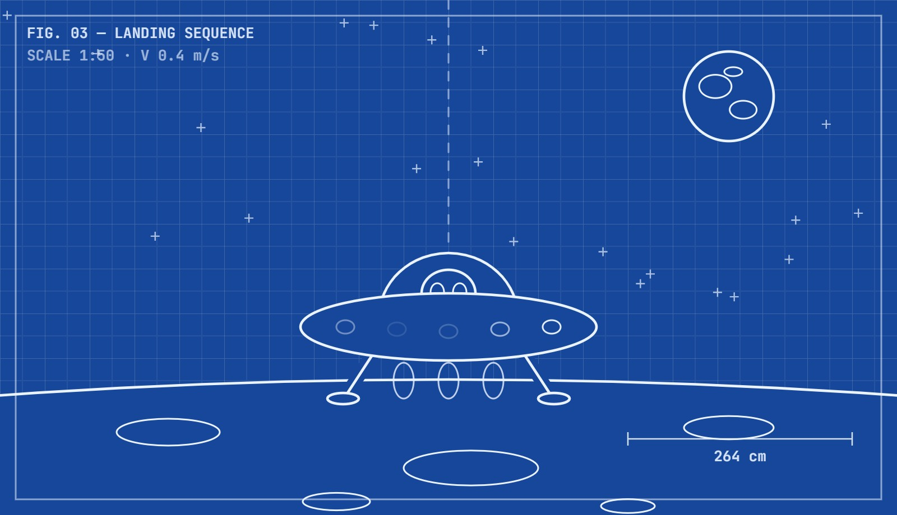

```text
Make an animated scene as ONE self-contained HTML file (inline SVG + vanilla JavaScript, no libraries, no external images or fonts), 16:9, looping every 6 seconds. Scene: [DESCRIBE YOUR SCENE HERE]. Draw every character and object from simple SVG shapes (ellipses, rounded rectangles, paths, thick round-capped lines for arms and legs). Drive everything from one time variable so the loop is seamless. Style: BLUEPRINT. A technical drawing on blueprint paper: background #17479A with a 40-px white grid at 16% opacity and a finer 20-px grid at 7%. Draw everything as thin white outlines (2.3 px, round joins); fill shapes with the background color so they hide the lines behind them. Add dashed construction lines, dimension lines with measurements, a thin frame, and a title block such as "FIG. 01 — LANDING SEQUENCE" in a monospace font with a live readout (speed, scale). Smooth 30 fps motion, like an engineering simulation.
```

## 04 · Neon


```text
Make an animated scene as ONE self-contained HTML file (inline SVG + vanilla JavaScript, no libraries, no external images or fonts), 16:9, looping every 6 seconds. Scene: [DESCRIBE YOUR SCENE HERE]. Draw every character and object from simple SVG shapes (ellipses, rounded rectangles, paths, thick round-capped lines for arms and legs). Drive everything from one time variable so the loop is seamless. Style: NEON. Dark night background (vertical gradient #0A0720 to #1A0B2E). Everything is glowing neon tubing: colored outlines 3 px wide (magenta #FF2BD6, cyan #00E5FF, lime #39FF14, yellow #FFF36B, violet #8E6BFF), shapes filled with near-black #090716 so they hide what is behind. Glow = an SVG filter that merges two copies blurred with stdDeviation 5, one blurred 1.4 and the sharp original. Draw faint horizontal scanlines over the frame (every 8 px, black at 28%). Smooth 30 fps.
```

## 05 · Flat Vector

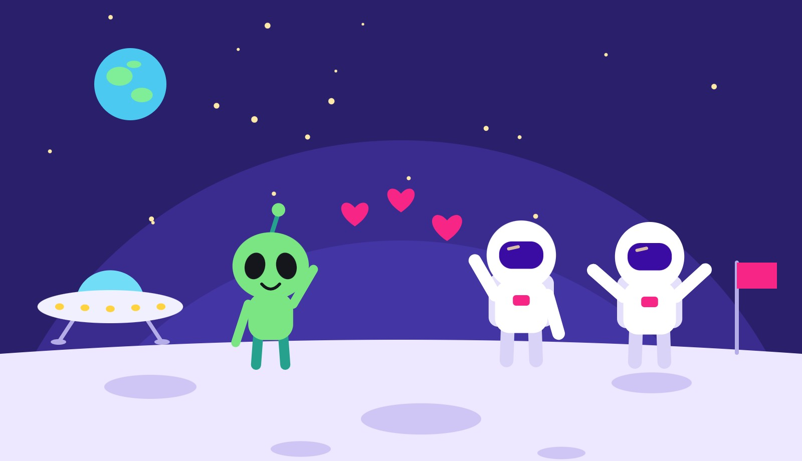

```text
Make an animated scene as ONE self-contained HTML file (inline SVG + vanilla JavaScript, no libraries, no external images or fonts), 16:9, looping every 6 seconds. Scene: [DESCRIBE YOUR SCENE HERE]. Draw every character and object from simple SVG shapes (ellipses, rounded rectangles, paths, thick round-capped lines for arms and legs). Drive everything from one time variable so the loop is seamless. Style: FLAT VECTOR. Modern flat motion graphics: bold solid shapes, no outlines, no gradients, no textures. Palette of 6 to 8 colors (deep purple background #2A1F6B, pink #F72585, cyan #4CC9F0, mint #80ED99, yellow #FFB703, white, lilac #EDE8FF). Use big simple geometric shapes in the background for depth. Smooth 30 fps with ease-in-out moves and a small overshoot (back-out easing) on every entrance.
```

## 06 · Comic Book

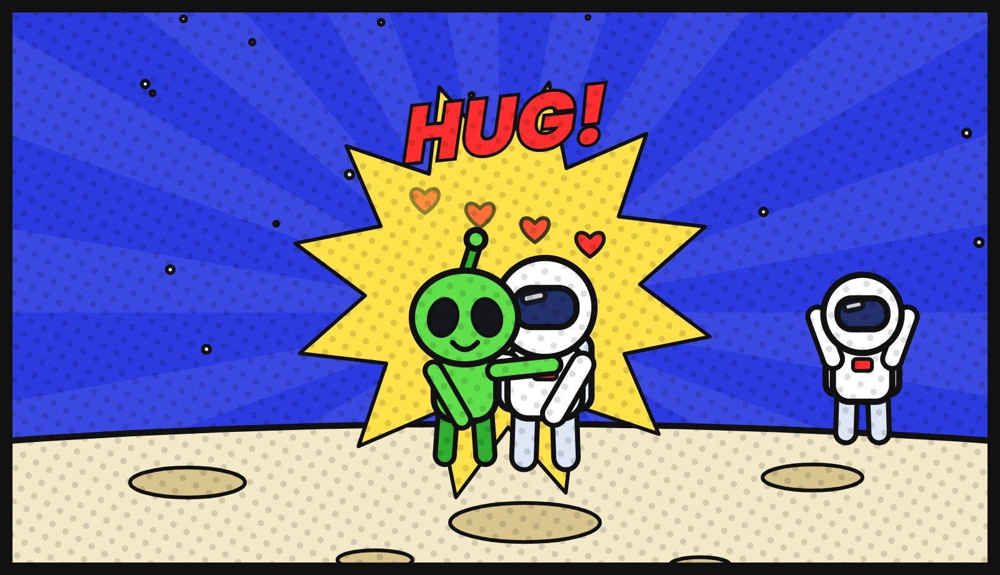

```text
Make an animated scene as ONE self-contained HTML file (inline SVG + vanilla JavaScript, no libraries, no external images or fonts), 16:9, looping every 6 seconds. Scene: [DESCRIBE YOUR SCENE HERE]. Draw every character and object from simple SVG shapes (ellipses, rounded rectangles, paths, thick round-capped lines for arms and legs). Drive everything from one time variable so the loop is seamless. Style: COMIC BOOK. A pop-art comic panel: saturated flat colors with a thick black outline (5 px, round joins) on every shape; arms and legs are a black line with a slightly thinner colored line on top. Cover the whole frame with a halftone pattern (12-px grid rotated 30 degrees, black dots, about 13% opacity), put radiating light rays in the background and a 10-px black border around the panel. At the key moment show an action word (for example "HUG!") in bold italic with a black stroke inside a yellow starburst. 12 fps with snappy poses.
```

## 07 · Chalkboard


```text
Make an animated scene as ONE self-contained HTML file (inline SVG + vanilla JavaScript, no libraries, no external images or fonts), 16:9, looping every 6 seconds. Scene: [DESCRIBE YOUR SCENE HERE]. Draw every character and object from simple SVG shapes (ellipses, rounded rectangles, paths, thick round-capped lines for arms and legs). Drive everything from one time variable so the loop is seamless. Style: CHALKBOARD. A green chalkboard (#2C5A4B) with a wooden frame. Everything is drawn in chalk: off-white and pastel strokes 5 to 6 px wide; fill shapes with the board color so they hide what is behind. Chalk texture = an SVG filter: feTurbulence (fractalNoise, baseFrequency 0.055) + feDisplacementMap scale 5 to make the lines wobble, then mask the result with a fine noise (baseFrequency 1.1) so the strokes look dusty. Animate at 8 fps and change the turbulence seed on every frame so the lines "boil" like hand-drawn animation.
```

## 08 · Claymation


```text
Make an animated scene as ONE self-contained HTML file (inline SVG + vanilla JavaScript, no libraries, no external images or fonts), 16:9, looping every 6 seconds. Scene: [DESCRIBE YOUR SCENE HERE]. Draw every character and object from simple SVG shapes (ellipses, rounded rectangles, paths, thick round-capped lines for arms and legs). Drive everything from one time variable so the loop is seamless. Style: CLAYMATION. Stop-motion modelling clay: rounded chunky shapes in warm saturated colors. Light every shape like a 3D lump of clay with an SVG lighting filter: blur the alpha (stdDeviation 4.5) → feDiffuseLighting (surfaceScale 7, distant light azimuth 235, elevation 52) multiplied over the color → feSpecularLighting (specularExponent 22) added on top for a soft highlight → a soft drop shadow. Dark purple studio backdrop with a radial gradient and subtle grain. 12 fps with tiny imperfections, squash and stretch.
```

## 09 · Risograph

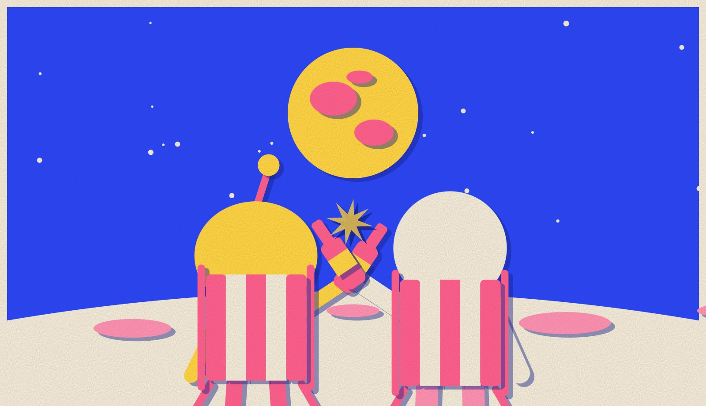

```text
Make an animated scene as ONE self-contained HTML file (inline SVG + vanilla JavaScript, no libraries, no external images or fonts), 16:9, looping every 6 seconds. Scene: [DESCRIBE YOUR SCENE HERE]. Draw every character and object from simple SVG shapes (ellipses, rounded rectangles, paths, thick round-capped lines for arms and legs). Drive everything from one time variable so the loop is seamless. Style: RISOGRAPH. A three-ink riso print: use ONLY cream paper #F3EAD7, blue #2742F5, pink #FF5C8A and yellow #FFD23F. Flat shapes, no outlines. Fake the misregistration: draw every colored shape twice, first a dark-blue ghost (#141C8A at 45%) shifted 5 px right and 4 px down, then the real shape on top. Multiply a heavy grain over everything (feTurbulence fractalNoise baseFrequency 0.85) and leave an 8-px cream paper margin around the frame. 12 fps.
```

## 10 · Watercolor

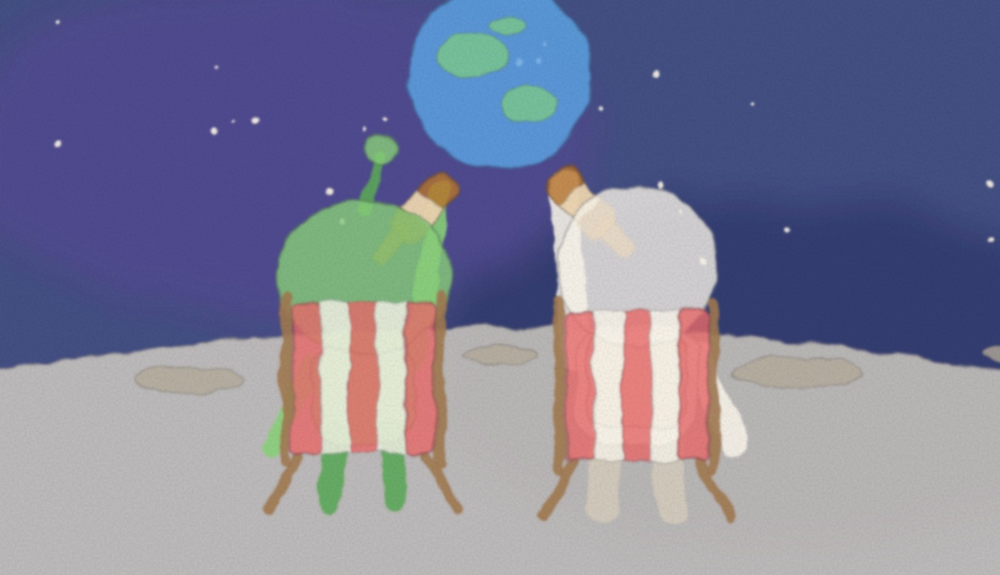

```text
Make an animated scene as ONE self-contained HTML file (inline SVG + vanilla JavaScript, no libraries, no external images or fonts), 16:9, looping every 6 seconds. Scene: [DESCRIBE YOUR SCENE HERE]. Draw every character and object from simple SVG shapes (ellipses, rounded rectangles, paths, thick round-capped lines for arms and legs). Drive everything from one time variable so the loop is seamless. Style: WATERCOLOR. Hand-painted watercolor on cream paper #F6F0E2: soft translucent fills (80% opacity) with a thin, slightly darker edge. Pass all the artwork through a filter that wobbles the edges (feTurbulence fractalNoise baseFrequency 0.035, 3 octaves + feDisplacementMap scale 9) and blurs it 0.9 px. The background is a large blurred wash of indigo and violet (displacement 60, blur 14) that does not reach the paper edges evenly. Multiply a paper grain on top. Slow, smooth 30 fps motion; change the turbulence seed every 6 frames so the paint seems to breathe.
```

## 11 · Stained Glass

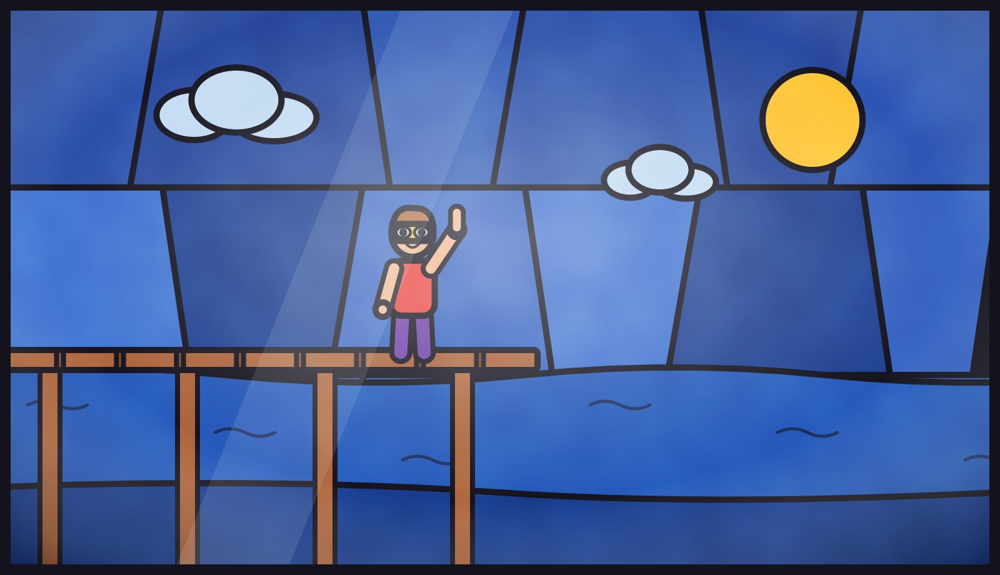

```text
Make an animated scene as ONE self-contained HTML file (inline SVG + vanilla JavaScript, no libraries, no external images or fonts), 16:9, looping every 6 seconds. Scene: [DESCRIBE YOUR SCENE HERE]. Draw every character and object from simple SVG shapes (ellipses, rounded rectangles, paths, thick round-capped lines for arms and legs). Drive everything from one time variable so the loop is seamless. Style: STAINED GLASS. A church window: every shape is a piece of colored glass with a thick dark lead line around it (stroke #14121C, 5 px, round joins); arms and legs are a colored line over a wider dark one. Build the background from large irregular glass panes in six close shades of blue, each with the same lead outline. Jewel palette (cobalt, emerald, ruby, amber). Light comes through the glass: lay a radial gradient over everything (white at 34% in the center, black at 42% at the corners), a coarse cloudy noise blended with overlay (feTurbulence baseFrequency 0.02) and a soft diagonal band of light that sweeps slowly across the frame. Finish with a 9-px dark frame. Smooth 30 fps.
```

## 12 · Shadow Puppet

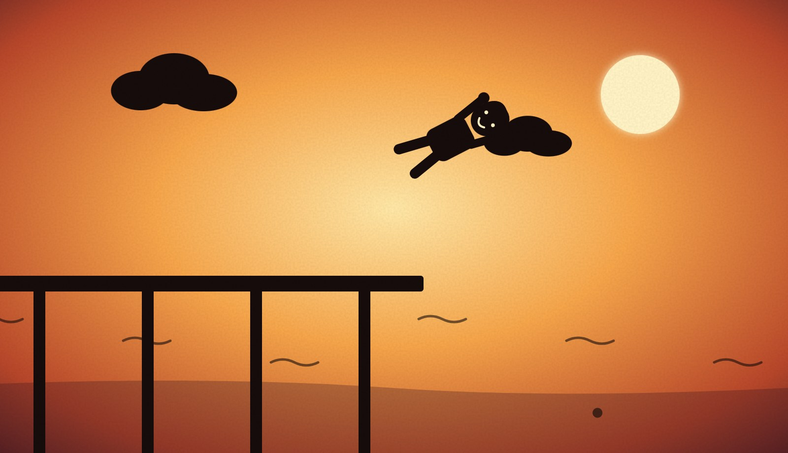

```text
Make an animated scene as ONE self-contained HTML file (inline SVG + vanilla JavaScript, no libraries, no external images or fonts), 16:9, looping every 6 seconds. Scene: [DESCRIBE YOUR SCENE HERE]. Draw every character and object from simple SVG shapes (ellipses, rounded rectangles, paths, thick round-capped lines for arms and legs). Drive everything from one time variable so the loop is seamless. Style: SHADOW PUPPET. A shadow theater: every character and object is a flat, near-black silhouette (#150C0B) with no outlines and no inner detail, in front of a backlit paper screen (radial gradient from warm cream #FFE7A6 in the center through orange #F6A54A and rust #B8472A to dark plum #3A1420 at the edges). Only light sources (sun, moon, stars, eyes, anything that glows) are cut out in pale light #FFF2C4 with a soft glow (Gaussian blur 4 merged under the sharp shape). Multiply a paper grain over the frame. Animate at 12 fps and rock the whole puppet layer by a quarter of a degree from frame to frame, as if held on sticks.
```

## 13 · Ukiyo-e

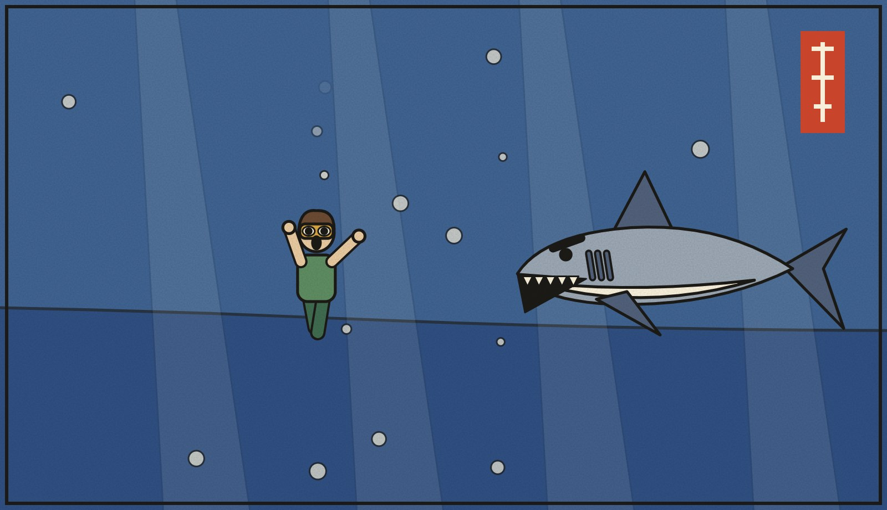

```text
Make an animated scene as ONE self-contained HTML file (inline SVG + vanilla JavaScript, no libraries, no external images or fonts), 16:9, looping every 6 seconds. Scene: [DESCRIBE YOUR SCENE HERE]. Draw every character and object from simple SVG shapes (ellipses, rounded rectangles, paths, thick round-capped lines for arms and legs). Drive everything from one time variable so the loop is seamless. Style: UKIYO-E. A Japanese woodblock print on cream paper #EFE3C8: flat muted inks (indigo #27457A, moss green, vermilion #C8452C, ochre #D9A441, warm grey) with a thin black-brown outline (#1B1A17, 2.6 px). The sky is a vertical gradient from indigo at the top to bare paper at the horizon, crossed by flat stylized cloud bands in cream. Rain is thin, dark, perfectly straight diagonal lines. Multiply a fine paper grain over everything, add a thin dark frame and a red vertical seal with pale strokes in the top right corner. 12 fps with calm, deliberate moves.
```

## 14 · Low Poly

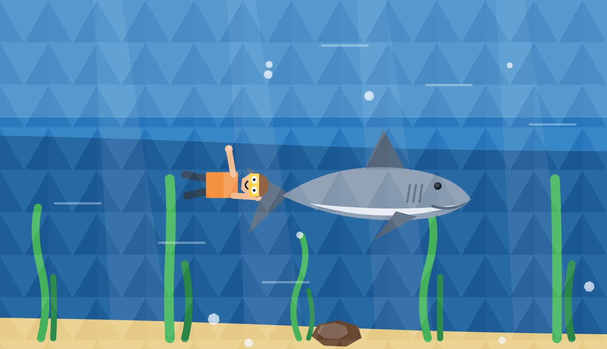

```text
Make an animated scene as ONE self-contained HTML file (inline SVG + vanilla JavaScript, no libraries, no external images or fonts), 16:9, looping every 6 seconds. Scene: [DESCRIBE YOUR SCENE HERE]. Draw every character and object from simple SVG shapes (ellipses, rounded rectangles, paths, thick round-capped lines for arms and legs). Drive everything from one time variable so the loop is seamless. Style: LOW POLY. Faceted like an early 3D game: no outlines, no curves. Draw every round shape as a 7- or 9-sided polygon with a second, smaller and lighter polygon inside it (white at 20%), offset up and to the left, as the lit facet; rectangles get square corners and a lighter top half. The sky is a vertical gradient (#4FA8E8 to #BDE8FA) covered by a pattern of triangles in slightly different tints (white at 16%, black at 10% and 20%), and the same triangle pattern is laid over the whole frame with soft-light blending. Smooth 30 fps.
```

## 15 · Bauhaus

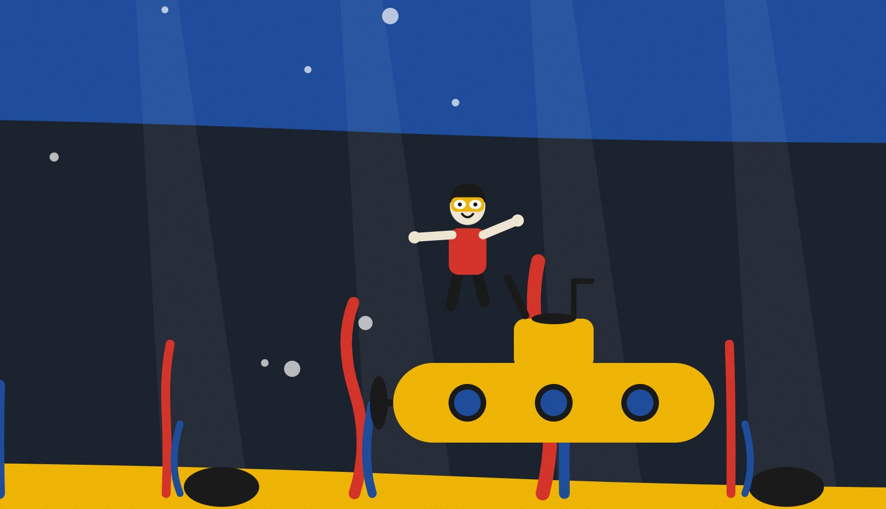

```text
Make an animated scene as ONE self-contained HTML file (inline SVG + vanilla JavaScript, no libraries, no external images or fonts), 16:9, looping every 6 seconds. Scene: [DESCRIBE YOUR SCENE HERE]. Draw every character and object from simple SVG shapes (ellipses, rounded rectangles, paths, thick round-capped lines for arms and legs). Drive everything from one time variable so the loop is seamless. Style: BAUHAUS. A 1920s Bauhaus poster: use ONLY red #D7352A, blue #1F4E9E, yellow #F2B705, black #1A1A1A and off-white paper #F2E8D5. Flat geometric shapes, no outlines, no gradients. Compose the background like a poster: thin black construction lines (one horizontal, one vertical, one large circle outline), a yellow square holding a blue circle in one corner and a red triangle in the opposite one. Reduce characters to circles, rectangles and straight lines. Multiply a light paper grain on top. Smooth 30 fps with precise, mechanical moves.
```

## 16 · Notebook Doodle

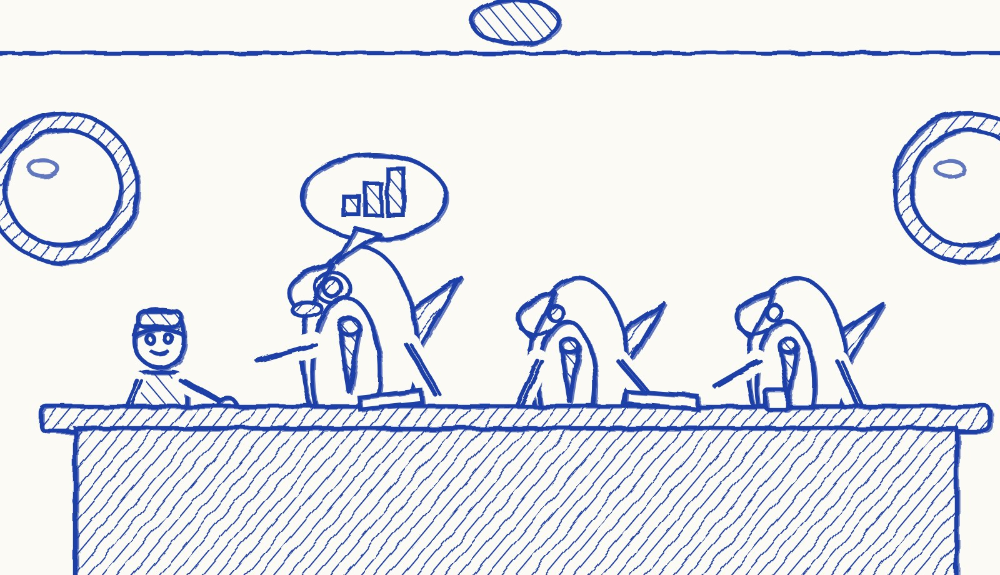

```text
Make an animated scene as ONE self-contained HTML file (inline SVG + vanilla JavaScript, no libraries, no external images or fonts), 16:9, looping every 6 seconds. Scene: [DESCRIBE YOUR SCENE HERE]. Draw every character and object from simple SVG shapes (ellipses, rounded rectangles, paths, thick round-capped lines for arms and legs). Drive everything from one time variable so the loop is seamless. Style: NOTEBOOK DOODLE. A ballpoint-pen doodle on a ruled notebook page: off-white paper #FBFAF4 with light-blue horizontal rules every 28 px, a red margin line on the left and three punched holes. Draw everything in blue pen only (#1F3FA8, 2.6-px strokes): fill each shape with the paper color so it hides what is behind, then go over the outline twice with a slight offset, like a hand retracing the line. Shade dark areas with diagonal hatching (a 7-px line pattern rotated 40 degrees) and mid tones with hatching in the opposite direction; never use a solid fill. Wobble the lines with feTurbulence (baseFrequency 0.05) + feDisplacementMap scale 4. Animate at 8 fps and change the turbulence seed on every frame so the drawing boils.
```

## 17 · Sticker

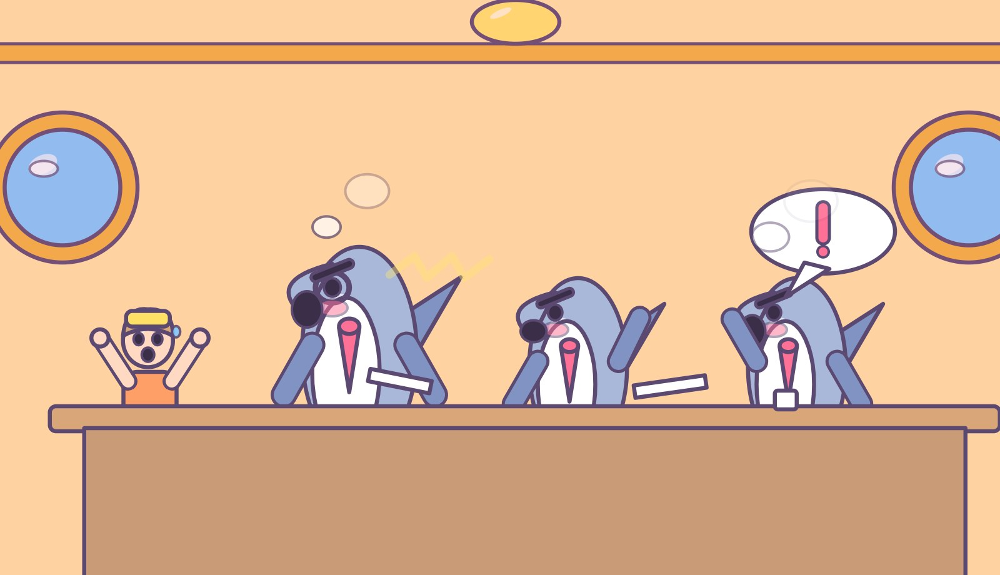

```text
Make an animated scene as ONE self-contained HTML file (inline SVG + vanilla JavaScript, no libraries, no external images or fonts), 16:9, looping every 6 seconds. Scene: [DESCRIBE YOUR SCENE HERE]. Draw every character and object from simple SVG shapes (ellipses, rounded rectangles, paths, thick round-capped lines for arms and legs). Drive everything from one time variable so the loop is seamless. Style: STICKER. A sheet of kawaii die-cut stickers: pastel candy colors with a thin plum outline (#5B4A72, 2.6 px) and a small white shine on every round shape. Wrap the whole drawing in a thick white sticker border with a soft shadow, using one SVG filter: feMorphology dilate radius 7 on the alpha → flood it white → feDropShadow (dy 6, blur 5, plum at 35%) → merge with the original on top. Background: pink #FFC3DD with a pattern of white polka dots. 12 fps with bouncy squash and stretch.
```

## 18 · Glitch

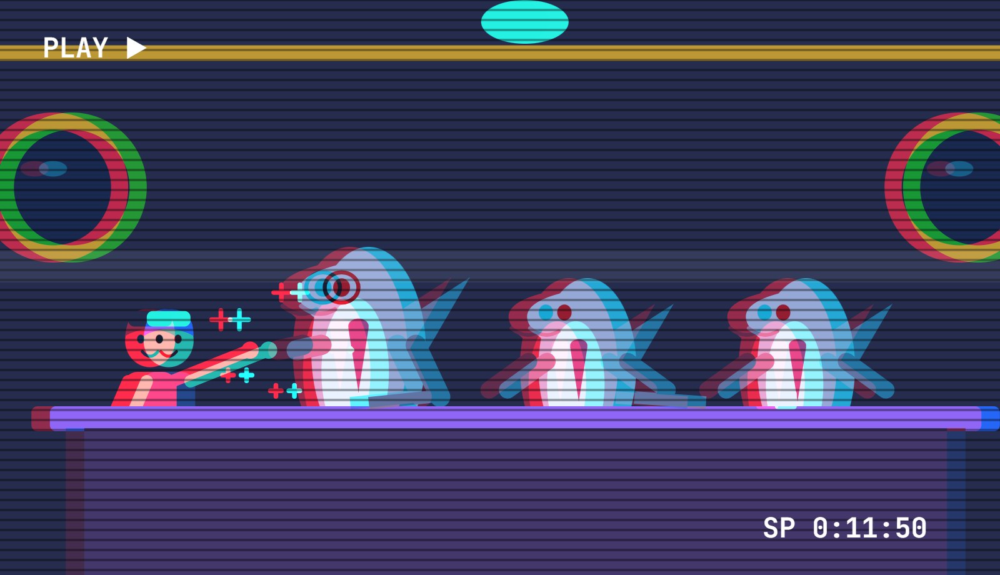

```text
Make an animated scene as ONE self-contained HTML file (inline SVG + vanilla JavaScript, no libraries, no external images or fonts), 16:9, looping every 6 seconds. Scene: [DESCRIBE YOUR SCENE HERE]. Draw every character and object from simple SVG shapes (ellipses, rounded rectangles, paths, thick round-capped lines for arms and legs). Drive everything from one time variable so the loop is seamless. Style: GLITCH. A damaged VHS tape: dark background #0D0F1A with flat neon colors (hot pink #FF3D7F, cyan #19F0E0, green #35E08A, violet #8A5CF6, cold white). Split the color channels: draw the whole scene twice with screen blending, once through a red-only feColorMatrix shifted a few pixels left and once through a green-and-blue-only matrix shifted the same amount right; change the shift (3 to 9 px) on every frame. About one frame in four, cut a horizontal band 16 to 56 px tall and slide it sideways by up to 30 px. On top: black scanlines every 8 px at 35%, a pale tracking bar drifting down the frame, and monospace camcorder text ("PLAY ▶" top left, a running tape counter bottom right). 30 fps.
```

## 19 · Felt & Stitch

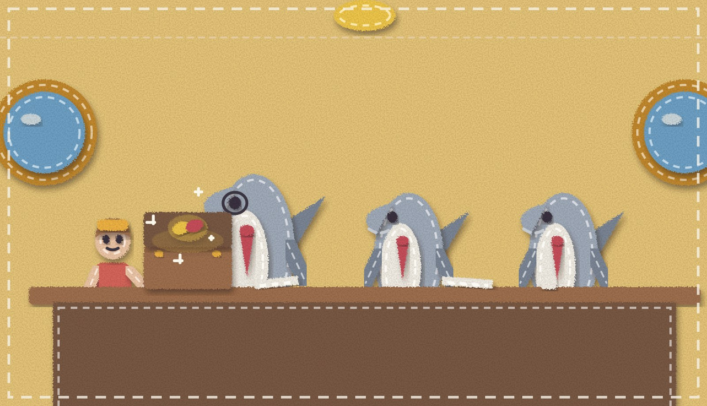

```text
Make an animated scene as ONE self-contained HTML file (inline SVG + vanilla JavaScript, no libraries, no external images or fonts), 16:9, looping every 6 seconds. Scene: [DESCRIBE YOUR SCENE HERE]. Draw every character and object from simple SVG shapes (ellipses, rounded rectangles, paths, thick round-capped lines for arms and legs). Drive everything from one time variable so the loop is seamless. Style: FELT AND STITCH. Hand-sewn felt craft: soft muted colors, no outlines. Every shape is a piece of felt: roughen its edge and add fuzz with one SVG filter (feTurbulence fractalNoise baseFrequency 0.9 → feDisplacementMap scale 3.5, the same noise overlaid as a faint dark speckle, then a soft drop shadow dx 2 dy 4) so the pieces look stacked. Sew each large piece on with a running stitch: a dashed line (stroke-dasharray 6 5, 2 px) in a lighter tint of the piece's color, 5 px inside its edge; thin details are dashed thread too. Background: pale blue felt with a multiplied fabric grain and a dashed cream stitch border around the frame. 12 fps, like stop motion.
```

## 20 · Art Deco

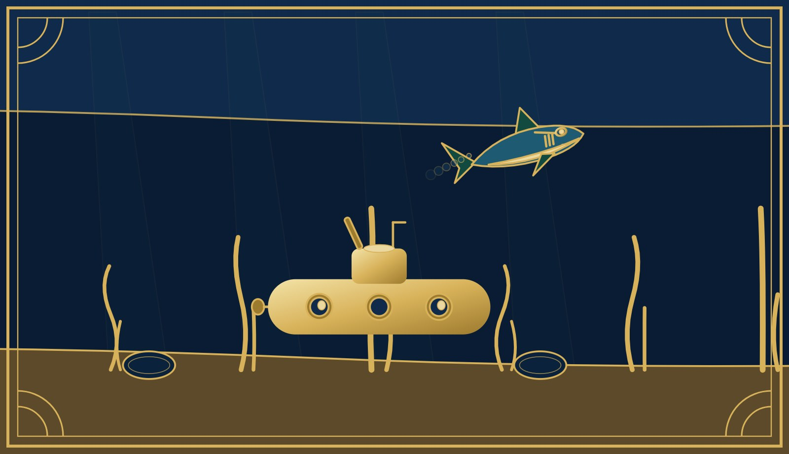

```text
Make an animated scene as ONE self-contained HTML file (inline SVG + vanilla JavaScript, no libraries, no external images or fonts), 16:9, looping every 6 seconds. Scene: [DESCRIBE YOUR SCENE HERE]. Draw every character and object from simple SVG shapes (ellipses, rounded rectangles, paths, thick round-capped lines for arms and legs). Drive everything from one time variable so the loop is seamless. Style: ART DECO. A 1920s luxury poster: deep navy background (vertical gradient #07101F to #13325A) with a fan of thin gold rays rising from the bottom center. Every shape is filled with a dark jewel tone (teal, petrol blue, burgundy) and outlined in gold (#D8B25A, 2.4 px); large round shapes get a second, thinner gold line inside. Anything that shines (sun, moon, stars, fruit, highlights) is filled with a metallic gold gradient (#F3E3A8 → #D8B25A → #9C7A2E). Arms, legs and strokes are plain gold lines. Finish with a double gold frame with quarter-circle ornaments in the four corners. Smooth 30 fps with elegant, slow moves.
```

## What it does not do

It does not generate photos, 3D renders or video files. The result is a web page that plays the animation; recording it to MP4 needs a separate tool.

---

Made by [Skillpedia](https://www.useskillpedia.com), the catalog of AI skills.
