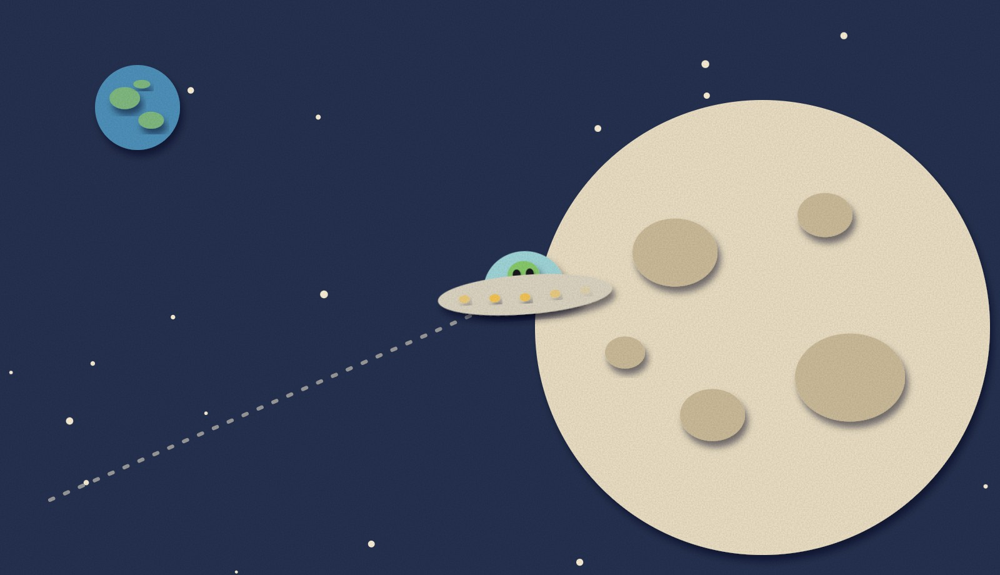
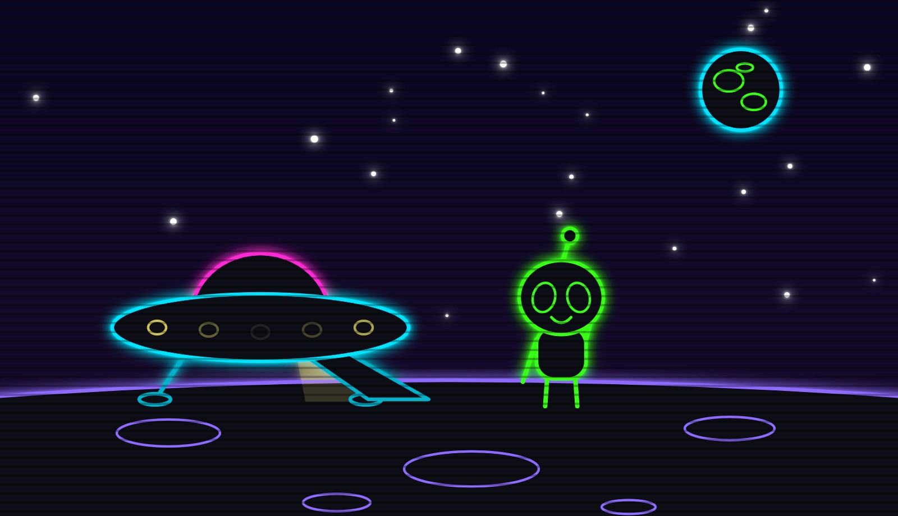
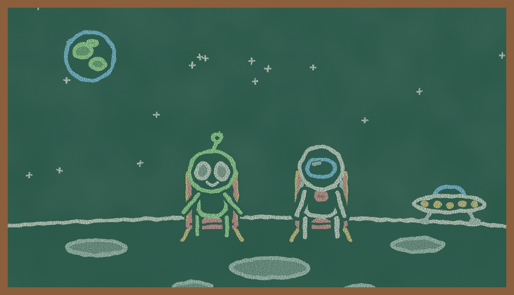
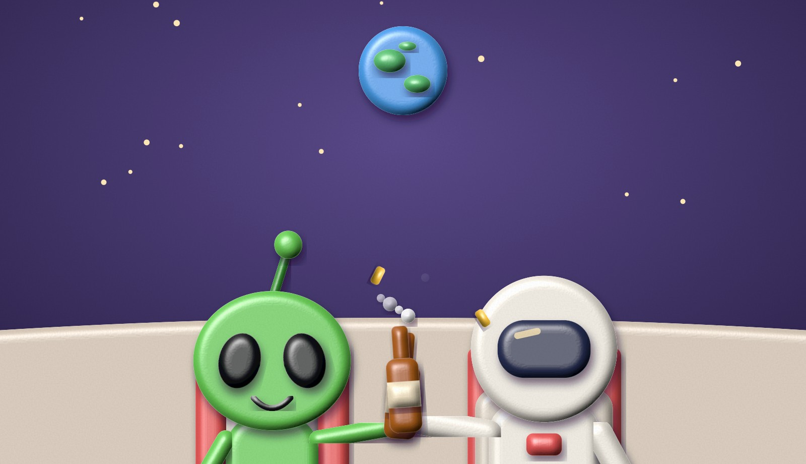

# 10 Claude animation styles

Ten animation styles that Claude (or any AI that writes code) can draw with nothing but inline SVG and a little JavaScript: pixel art, paper cutout, blueprint, neon, flat vector, comic book, chalkboard, claymation, risograph and watercolor. One prompt per style, with a picture of what it looks like.

## Two ways to use it

**1. Give your AI the whole skill.** Paste this into the chat and name the style you want:

```text
Read https://raw.githubusercontent.com/pahesilva1/skillpedia-skills/main/claude-animation-styles/SKILL.md and follow it. Animate this scene in the [STYLE NAME] style: [DESCRIBE YOUR SCENE HERE].
```

In Claude Code, Codex or Cursor you can also install it: `npx skills add pahesilva1/skillpedia-skills --skill claude-animation-styles`

**2. Copy a single prompt.** Pick a style below, copy its prompt, replace `[DESCRIBE YOUR SCENE HERE]` with your scene and paste it into your AI. It answers with one HTML file: open it in your browser to watch the animation. To see the same scene in another style, keep your scene and use the next prompt.

## 01 · Pixel Art


```text
Make an animated scene as ONE self-contained HTML file (inline SVG + vanilla JavaScript, no libraries, no external images or fonts), 16:9, looping every 6 seconds. Scene: [DESCRIBE YOUR SCENE HERE]. Draw every character and object from simple SVG shapes (ellipses, rounded rectangles, paths, thick round-capped lines for arms and legs). Drive everything from one time variable so the loop is seamless. Style: PIXEL ART. Flat colors only, no outlines and no gradients. Snap the whole drawing to an 8-px grid with an SVG mosaic filter: feFlood (x=3 y=3 width=2 height=2) → feComposite (width=8 height=8) → feTile → feComposite in=SourceGraphic operator=in → feMorphology dilate radius=4. The filter must use filterUnits="userSpaceOnUse" covering the whole frame, and the group needs shape-rendering="crispEdges". Use a small retro-console palette (deep navy background, 12 to 16 saturated colors). Animate at 12 frames per second and move things in whole-pixel steps. Stars are single 8-px squares.
```

## 02 · Paper Cutout



```text
Make an animated scene as ONE self-contained HTML file (inline SVG + vanilla JavaScript, no libraries, no external images or fonts), 16:9, looping every 6 seconds. Scene: [DESCRIBE YOUR SCENE HERE]. Draw every character and object from simple SVG shapes (ellipses, rounded rectangles, paths, thick round-capped lines for arms and legs). Drive everything from one time variable so the loop is seamless. Style: PAPER CUTOUT. Every shape is a piece of cut paper: flat muted colors (kraft, cream, dusty blue, sage, mustard), no outlines. Give each layer a soft drop shadow (feDropShadow dx=2.5 dy=5 stdDeviation=2.6, dark, 50% opacity) so the layers look stacked on a table. Add a paper-grain overlay on top (feTurbulence fractalNoise baseFrequency=0.9, blended with multiply at about 50%). Animate on twos (12 fps) like stop motion: layers slide, tilt and rotate, they never morph.
```

## 03 · Blueprint


```text
Make an animated scene as ONE self-contained HTML file (inline SVG + vanilla JavaScript, no libraries, no external images or fonts), 16:9, looping every 6 seconds. Scene: [DESCRIBE YOUR SCENE HERE]. Draw every character and object from simple SVG shapes (ellipses, rounded rectangles, paths, thick round-capped lines for arms and legs). Drive everything from one time variable so the loop is seamless. Style: BLUEPRINT. A technical drawing on blueprint paper: background #17479A with a 40-px white grid at 16% opacity and a finer 20-px grid at 7%. Draw everything as thin white outlines (2.3 px, round joins); fill shapes with the background color so they hide the lines behind them. Add dashed construction lines, dimension lines with measurements, a thin frame, and a title block such as "FIG. 01 — LANDING SEQUENCE" in a monospace font with a live readout (speed, scale). Smooth 30 fps motion, like an engineering simulation.
```

## 04 · Neon



```text
Make an animated scene as ONE self-contained HTML file (inline SVG + vanilla JavaScript, no libraries, no external images or fonts), 16:9, looping every 6 seconds. Scene: [DESCRIBE YOUR SCENE HERE]. Draw every character and object from simple SVG shapes (ellipses, rounded rectangles, paths, thick round-capped lines for arms and legs). Drive everything from one time variable so the loop is seamless. Style: NEON. Dark night background (vertical gradient #0A0720 to #1A0B2E). Everything is glowing neon tubing: colored outlines 3 px wide (magenta #FF2BD6, cyan #00E5FF, lime #39FF14, yellow #FFF36B, violet #8E6BFF), shapes filled with near-black #090716 so they hide what is behind. Glow = an SVG filter that merges two copies blurred with stdDeviation 5, one blurred 1.4 and the sharp original. Draw faint horizontal scanlines over the frame (every 8 px, black at 28%). Smooth 30 fps.
```

## 05 · Flat Vector


```text
Make an animated scene as ONE self-contained HTML file (inline SVG + vanilla JavaScript, no libraries, no external images or fonts), 16:9, looping every 6 seconds. Scene: [DESCRIBE YOUR SCENE HERE]. Draw every character and object from simple SVG shapes (ellipses, rounded rectangles, paths, thick round-capped lines for arms and legs). Drive everything from one time variable so the loop is seamless. Style: FLAT VECTOR. Modern flat motion graphics: bold solid shapes, no outlines, no gradients, no textures. Palette of 6 to 8 colors (deep purple background #2A1F6B, pink #F72585, cyan #4CC9F0, mint #80ED99, yellow #FFB703, white, lilac #EDE8FF). Use big simple geometric shapes in the background for depth. Smooth 30 fps with ease-in-out moves and a small overshoot (back-out easing) on every entrance.
```

## 06 · Comic Book


```text
Make an animated scene as ONE self-contained HTML file (inline SVG + vanilla JavaScript, no libraries, no external images or fonts), 16:9, looping every 6 seconds. Scene: [DESCRIBE YOUR SCENE HERE]. Draw every character and object from simple SVG shapes (ellipses, rounded rectangles, paths, thick round-capped lines for arms and legs). Drive everything from one time variable so the loop is seamless. Style: COMIC BOOK. A pop-art comic panel: saturated flat colors with a thick black outline (5 px, round joins) on every shape; arms and legs are a black line with a slightly thinner colored line on top. Cover the whole frame with a halftone pattern (12-px grid rotated 30 degrees, black dots, about 13% opacity), put radiating light rays in the background and a 10-px black border around the panel. At the key moment show an action word (for example "HUG!") in bold italic with a black stroke inside a yellow starburst. 12 fps with snappy poses.
```

## 07 · Chalkboard



```text
Make an animated scene as ONE self-contained HTML file (inline SVG + vanilla JavaScript, no libraries, no external images or fonts), 16:9, looping every 6 seconds. Scene: [DESCRIBE YOUR SCENE HERE]. Draw every character and object from simple SVG shapes (ellipses, rounded rectangles, paths, thick round-capped lines for arms and legs). Drive everything from one time variable so the loop is seamless. Style: CHALKBOARD. A green chalkboard (#2C5A4B) with a wooden frame. Everything is drawn in chalk: off-white and pastel strokes 5 to 6 px wide; fill shapes with the board color so they hide what is behind. Chalk texture = an SVG filter: feTurbulence (fractalNoise, baseFrequency 0.055) + feDisplacementMap scale 5 to make the lines wobble, then mask the result with a fine noise (baseFrequency 1.1) so the strokes look dusty. Animate at 8 fps and change the turbulence seed on every frame so the lines "boil" like hand-drawn animation.
```

## 08 · Claymation



```text
Make an animated scene as ONE self-contained HTML file (inline SVG + vanilla JavaScript, no libraries, no external images or fonts), 16:9, looping every 6 seconds. Scene: [DESCRIBE YOUR SCENE HERE]. Draw every character and object from simple SVG shapes (ellipses, rounded rectangles, paths, thick round-capped lines for arms and legs). Drive everything from one time variable so the loop is seamless. Style: CLAYMATION. Stop-motion modelling clay: rounded chunky shapes in warm saturated colors. Light every shape like a 3D lump of clay with an SVG lighting filter: blur the alpha (stdDeviation 4.5) → feDiffuseLighting (surfaceScale 7, distant light azimuth 235, elevation 52) multiplied over the color → feSpecularLighting (specularExponent 22) added on top for a soft highlight → a soft drop shadow. Dark purple studio backdrop with a radial gradient and subtle grain. 12 fps with tiny imperfections, squash and stretch.
```

## 09 · Risograph


```text
Make an animated scene as ONE self-contained HTML file (inline SVG + vanilla JavaScript, no libraries, no external images or fonts), 16:9, looping every 6 seconds. Scene: [DESCRIBE YOUR SCENE HERE]. Draw every character and object from simple SVG shapes (ellipses, rounded rectangles, paths, thick round-capped lines for arms and legs). Drive everything from one time variable so the loop is seamless. Style: RISOGRAPH. A three-ink riso print: use ONLY cream paper #F3EAD7, blue #2742F5, pink #FF5C8A and yellow #FFD23F. Flat shapes, no outlines. Fake the misregistration: draw every colored shape twice, first a dark-blue ghost (#141C8A at 45%) shifted 5 px right and 4 px down, then the real shape on top. Multiply a heavy grain over everything (feTurbulence fractalNoise baseFrequency 0.85) and leave an 8-px cream paper margin around the frame. 12 fps.
```

## 10 · Watercolor


```text
Make an animated scene as ONE self-contained HTML file (inline SVG + vanilla JavaScript, no libraries, no external images or fonts), 16:9, looping every 6 seconds. Scene: [DESCRIBE YOUR SCENE HERE]. Draw every character and object from simple SVG shapes (ellipses, rounded rectangles, paths, thick round-capped lines for arms and legs). Drive everything from one time variable so the loop is seamless. Style: WATERCOLOR. Hand-painted watercolor on cream paper #F6F0E2: soft translucent fills (80% opacity) with a thin, slightly darker edge. Pass all the artwork through a filter that wobbles the edges (feTurbulence fractalNoise baseFrequency 0.035, 3 octaves + feDisplacementMap scale 9) and blurs it 0.9 px. The background is a large blurred wash of indigo and violet (displacement 60, blur 14) that does not reach the paper edges evenly. Multiply a paper grain on top. Slow, smooth 30 fps motion; change the turbulence seed every 6 frames so the paint seems to breathe.
```

## What it does not do

It does not generate photos, 3D renders or video files. The result is a web page that plays the animation; recording it to MP4 needs a separate tool.

---

Made by [Skillpedia](https://www.useskillpedia.com), the catalog of AI skills.
